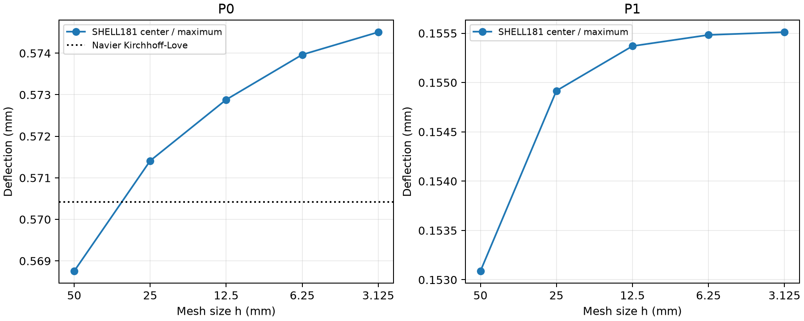
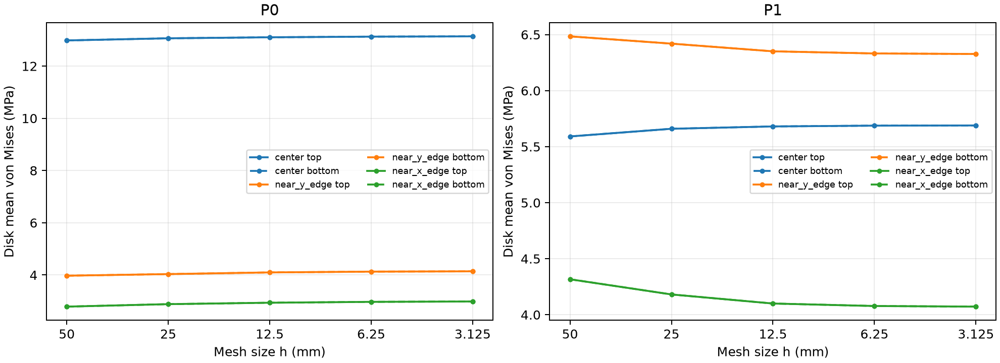
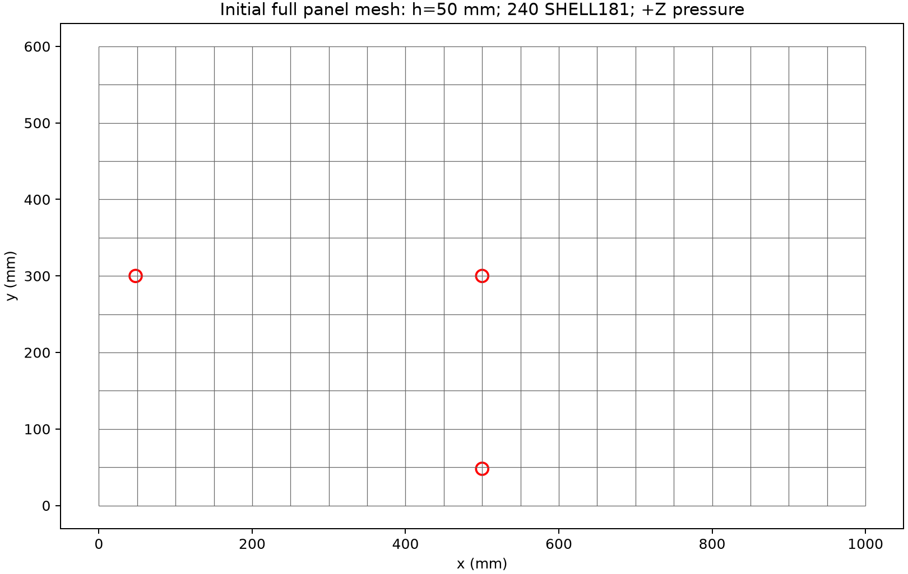
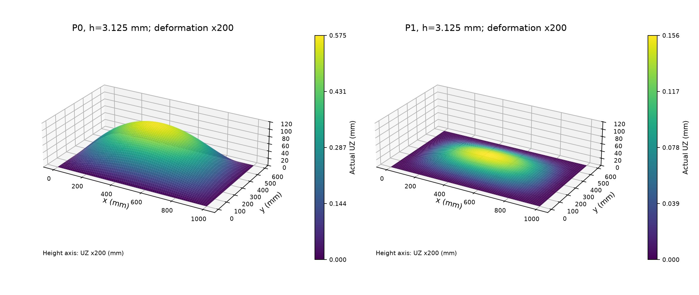

# Стальная панель: выполненный эксперимент 16 ноября 2026

Дополнено аудитом без новых запусков ANSYS:
[подробные таблицы TOP/BOTTOM, независимая квадратура и reference по метрикам](ANSYS_PANEL_AUDIT_20261116.md).
Уточнение: P0 стабилизирован отдельно по прогибам, энергии и VM двух площадок,
но не по VM площадки (48,300). Вывод о reference P1 относится к исходному
набору контрольных метрик и не распространяется на глобальный максимум VM.
Дополнительная попытка независимого чтения первичных RST старым бинарным
читателем не прошла; её результаты и ограничения отдельно сохранены в аудите.
Опубликованные числа не заменялись выдачей этого читателя.

В ANSYS MAPDL 2026 R1 действительно выполнены и приняты **11 расчётов**:
P0/P1 на пяти равномерных сетках и P1 с NLGEOM,ON на последней сетке.
Независимый аудит сохранённых экспортов прошёл для всех 11 случаев.
**P1 удовлетворяет критериям стабилизации; P0 на доступной серии ещё нет.**
Это исследовательская панель, не геометрия бака и не утверждённое ТЗ ЭРСО.
Постановка полностью приведена в [ANSYS_PANEL_SPEC.md](ANSYS_PANEL_SPEC.md).

## Код, среда и происхождение

- [Код и команды](../experiments/ansys_panel/README.md),
  [конфигурация](../experiments/ansys_panel/panel.json).
- Выбранный компактный набор:
  [runs/20261116_panel03](../experiments/ansys_panel/runs/20261116_panel03/).
- [comparison.csv](../experiments/ansys_panel/runs/20261116_panel03/comparison.csv)
  содержит сетки, узлы, фактические уравнения, прогибы, энергии, балансы и времена.
- [disk_stresses.csv](../experiments/ansys_panel/runs/20261116_panel03/disk_stresses.csv)
  содержит обе поверхности и все контрольные площадки, включая компоненты.
- [Полные компактные измерения](../experiments/ansys_panel/runs/20261116_panel03/measurements.json),
  [переходы сходимости](../experiments/ansys_panel/runs/20261116_panel03/summary.json),
  [аудит экспортов](../experiments/ansys_panel/runs/20261116_panel03/export_audit.json),
  [цепочка исходных manifest и сессий](../experiments/ansys_panel/runs/20261116_panel03/solve_provenance.json),
  [SHA-256 артефактов](../experiments/ansys_panel/runs/20261116_panel03/artifact_manifest.json).

Фактически использованы Python 3.11.9 x64, PyMAPDL 0.74.1, MAPDL 26.1
(Ansys Mechanical Enterprise), NumPy 2.4.6, SciPy 1.17.1. Ничего не устанавливалось.
Собственные gRPC-сессии работали на наблюдённом localhost endpoint
127.0.0.1:50052; это запись выполнения, а не требуемый порт будущих запусков.
В каждом launcher указаны nproc=2 и `-smp`. В finally вызывался exit только
созданной сессии; посторонние процессы не завершались. Ошибок закрытия нет.

MAPDL executable передавался аргументом:
`D:\ansyss\ANSYS Inc\v261\ansys\bin\winx64\ansys261.exe`.
Использован Python
`C:\Users\arist\Documents\ChatGPT\сетки\.venv\Scripts\python.exe`.
Эти пути записаны как происхождение; в переносимые расчётные модули они не зашиты.
Бинарные файлы, APDL и полные журналы остаются в новых каталогах
`%LOCALAPPDATA%\ansys_panel_runs\`; точный runtime каждого случая указан в JSON.

## Линейные решения

Единицы N, mm, MPa. SHELL181: KEYOPT(1)=0, (3)=2, (8)=2,
ETCONTROL,OFF; 5 точек Симпсона по толщине, SECOFFSET,MID.
Изменялась только сетка; материал, толщина, давление и закрепления сохранялись.
Во всех линейных случаях центральный прогиб совпал с максимальным |UZ|.
Число активных DoF взято из строки решателя Number of equations и независимо
сверено с числом узлов и предписанных степеней свободы, а не выдано как 6N.

| h, mm | Элементы | Узлы | P0 DoF | P0 w, mm | P1 DoF | P1 w, mm |
|---:|---:|---:|---:|---:|---:|---:|
| 50 | 240 | 273 | 1571 | 0.568753374 | 1254 | 0.153087293 |
| 25 | 960 | 1025 | 6019 | 0.571410474 | 5382 | 0.154916843 |
| 12.5 | 3840 | 3969 | 23555 | 0.572881637 | 22278 | 0.155369774 |
| 6.25 | 15360 | 15617 | 93187 | 0.573964241 | 90630 | 0.155482909 |
| 3.125 | 61440 | 61953 | 370691 | 0.574506578 | 365574 | 0.155511217 |



## Независимый ряд Навье для P0

Получено D = 9 846 153.846154 N mm и
**w_Navier(500,300) = 0.5704154218583822 mm**.
Величина соответствует заданному ориентиру 0.570415 mm.

| Нечётных членов по оси | Центральный прогиб, mm |
|---:|---:|
| 4 | 0.570322008370 |
| 8 | 0.570412047729 |
| 16 | 0.570415311872 |
| 32 | 0.570415418385 |
| 64 | 0.570415421753 |
| 128 | 0.570415421858 |

Последние относительные изменения 5.90e-9 и 1.85e-10 прошли допуск 1e-7.
Подробности в navier.json. Разности P0 относительно Навье по сеткам:
−0.291375%, +0.174443%, +0.432354%, +0.622146%, +0.717224%.
Нельзя принимать близость грубой сетки к Навье за доказательство точности:
сгущение увеличивает прогиб оболочечной модели.

Нормали, знак давления, закрепления, баланс, настройки элемента и экспорт
напряжений проверены. P0 сохраняет все изгибные повороты свободными по кромкам.
Это соответствует мягкому шарнирному условию для сдвиговой модели пластины.
Первичный источник Arnold–Falk описывает отличия мягкого шарнира от жёсткого
и поправки сдвиговой теории к пределу Кирхгофа–Лява:
[SIAM J. Math. Anal. 27(2), 1996](https://www-users.cse.umn.edu/~arnold/papers/bdlayer2.pdf).
Интерпретация расхождения как сочетания различия теорий/условий и остаточной
дискретизационной ошибки — гипотеза. Этот эксперимент не выделил их вклады
и не доказал происхождение всей разности 0.717224%. Закрепления не менялись,
чтобы приблизить результат к аналитическому ориентиру.

## Стабилизация и reference

Показаны последние два перехода. Относительные изменения нормированы по
более подробному решению; максимум VM берётся по трём кругам обеих поверхностей.

| Постановка | h coarse → fine, mm | Δw, % | ΔSENE, % | max Δ среднего VM, % | Все критерии |
|---|---:|---:|---:|---:|---|
| P0 | 12.5 → 6.25 | 0.188619 | 0.264449 | 1.112988 | нет |
| P0 | 6.25 → 3.125 | 0.094400 | 0.122339 | 0.500441 | да |
| P1 | 12.5 → 6.25 | 0.072764 | 0.126711 | 0.543458 | да |
| P1 | 6.25 → 3.125 | 0.018203 | 0.031716 | 0.136748 | да |

Для P0 переход 12.5 → 6.25 не прошёл по площадке (48,300) обеих поверхностей:
1.112988% превышает 1%. Последний переход прошёл, но двух последовательных
проходов нет. **Reference P0 не выбран.** Достигнут заданный последний уровень;
дополнительных сеток сверх запроса не запускали.

Для P1 последняя сетка 3.125 mm принята как **численный reference по заданным
критериям стабилизации**, с двумя последовательными проходами.
Это не точное решение и не строгая граница ошибки. Во всех кругах и случаях
квадратура прошла собственную проверку стабилизации; выбор ближайшего узла
или случайных центров элементов не использовался.

## Реакции, энергия, качество

Сумма приложенного давления +3000 N вдоль Z подтверждена знаком прогиба
и реакциями. Внешний момент относительно начала координат:
(900000, −1500000, 0) N mm. Реактивный момент включает r×F и узловые моменты.

| Случай, h=3.125 mm | ΣRz, N | SENE, N mm |
|---|---:|---:|
| P0 linear | −3000.000000403 | 368.500813288 |
| P1 linear | −3000.000000073 | 76.545695185 |
| P1 nonlinear | −3000.000015596 | 76.525244955 |

По всем 11 случаям max abs(ΣRz+3000)/3000 = **5.20e-9**, меньше 0.001.
Максимальная относительная невязка полного момента — 5.20e-9.
Максимальное расхождение SENE и половины внешней работы в линейных решениях
5.72e-9. Для нелинейного решения половина работы конечной опорной нагрузки
не является тождеством энергии: этот показатель там только диагностический.
AENE линейных решений равна нулю; в NL P1 она 3.79e-8 N mm.

Проверены все созданные четырёхугольники: нормаль +Z, aspect ratio 1,
углы 90°, warpage 0; det J = h²/4 > 0. Это геометрическая проверка фактической
связности и координат. CHECK не сообщил предупреждений о качестве.
Дополнительных drilling-закреплений не вводилось. Положительные крайние pivots
и отсутствие сообщений о механизме согласуются с корректным устранением
жёстких перемещений; отдельный модальный анализ не выполнялся.

## Напряжения и геометрическая нелинейность

Ниже средние напряжения Мизеса на неизменных кругах радиуса 8 mm, MPa.
В линейных решениях VM верхней/нижней поверхностей совпадает, а компоненты
меняют знак. Все компоненты σx, σy, τxy и их абсолютные/нормированные изменения
доступны в CSV/JSON. Усредняется интерполированный глобальный тензор;
средний VM вычисляется из тензора в точках интегрирования, а не из среднего тензора.

| Случай, h=3.125 mm | (500,300) | (500,48) | (48,300) |
|---|---:|---:|---:|
| P0 linear TOP/BOT | 13.138041 | 4.141357 | 2.986539 |
| P1 linear TOP/BOT | 5.689231 | 6.327003 | 4.072345 |
| P1 nonlinear TOP | 5.721922 | 6.291823 | 4.057680 |
| P1 nonlinear BOT | 5.653464 | 6.359378 | 4.085813 |

Внутренний/глобальный максимум восстановленного VM на последней линейной сетке:
P0 — 13.141151/13.141151 MPa; P1 — 8.949418/11.691219 MPa.
NL P1: TOP 8.914761/11.657385 MPa; BOT 8.980807/11.721573 MPa.
Это максимумы документированного билинейно восстановленного узлового поля,
не скрытые максимумы в интеграционных точках. Наибольший диагностический VM
среди всех случаев 13.141151 MPa < 235 MPa. Нормативная допустимость не выводится.



NL P1 при той же сетке и нагрузке дал w = **0.155476802135 mm** вместо
0.155511216573 mm. Абсолютная разность 0.000034414438 mm;
относительная 0.022135% при знаменателе NL. Максимальная относительная
разность контрольного среднего VM — **0.632653%**, BOT центрального круга,
также при знаменателе NL. Все контролируемые прогибы и площадочные VM
прошли порог 2%; пересмотр линейного приближения по этому тесту не требуется.
Это заключение ограничено данной панелью, давлением и метриками.
Сошлись 4 адаптивных подшага до TIME=1, всего 5 итераций равновесия;
raw SOLU,CNVG = 1. Solve занял 247.33 s, экспорт 5.99 s.




На деформированных изображениях перемещения увеличены **в 200 раз**;
шкала высоты единая для P0/P1, цветовая шкала подписана фактическими UZ в mm.

## Проверки, предупреждения и ограничения

10 численных unit-тестов прошли: ряд Навье, симметрия/масштабирование,
постоянные и линейные тензорные поля на физических кругах, квадратура,
обрезанные области максимума и логика двух последовательных переходов.
Независимый audit_exports проверил 11/11 случаев: хеши, связность, DoF,
конечные массивы, финальную нагрузку, балансы и линейную энергию. Явный
PRNSOL TOP/BOT в глобальной системе совпал с шестикомпонентными массивами
в центре; линейная антисимметрия поверхностей также проверена.

PyMAPDL автоматически включает /VERIFY при подключении. В принятых запусках
он явно отключён перед моделированием, что проверено по журналам. Исходный
CNVG линейных расчётов вернулся 0 и сохранён без исправления; приёмка линейных
решений основана на завершённом шаге, читаемом результате при TIME=1,
конечности полей, балансе и энергетической проверке. Это не выдаётся за CNVG=1.
Для NL флаг равен 1. Маркеров WARNING/ERROR в принятых solve нет.
Строки старого coarse-экспорта с обычным текстом «no warnings or errors» и
pivot не являются предупреждениями; исходные JSON сохранены без исправления.

Два дополнительных P0 h=50 solve на этапе отладки экспорта не входят в таблицу:
первая обработка остановилась из-за пустого перенаправленного solve.out
(реальный текст вернулся через gRPC), вторая — из-за линейного CNVG=0.
Они сохранены в `.local/panel-coarse-01` и `panel-coarse-02` с failure.json;
эти попытки не публикуются как принятые результаты. Изменений физической
постановки между ними и принятыми запусками не было.

ASMR++, обучение и новый inference не выполнялись. Начальная checksum-проверка
сохранённого ASMR++ комплекта прошла: 17 артефактов, код 0; исторические файлы
не изменялись. Это отдельная проверка целостности, не часть ANSYS-эксперимента.
Не исследованы пластичность, потеря устойчивости, реальные швы/рёбра/контакты,
температура, допуски изготовления, нормативы и геометрия бака.

## Фактически выполненные команды

Из корня репозитория, существующим интерпретатором PANEL_PYTHON:

```powershell
& $env:PANEL_PYTHON -B -I -S -X utf8 experiments/asmrpp/reproduce/reproduce.py --verify-only
& $env:PANEL_PYTHON -B -X utf8 -m unittest discover -s experiments/ansys_panel -p test_analysis.py -v
& $env:PANEL_PYTHON -B -X utf8 experiments/ansys_panel/run_panel.py --exec-file $env:PYMAPDL_MAPDL_EXEC --runtime-root "$env:LOCALAPPDATA\ansys_panel_runs" --output .local/panel-coarse-03 --levels 0 1
& $env:PANEL_PYTHON -B -X utf8 experiments/ansys_panel/run_panel.py --exec-file $env:PYMAPDL_MAPDL_EXEC --runtime-root "$env:LOCALAPPDATA\ansys_panel_runs" --output .local/panel-refined-01 --previous .local/panel-coarse-03 --levels 2 3 4 --nonlinear
& $env:PANEL_PYTHON -B -X utf8 experiments/ansys_panel/audit_exports.py --measurements .local/panel-refined-01/measurements.json --output .local/panel-audit-final-01/audit.json
& $env:PANEL_PYTHON -B -X utf8 experiments/ansys_panel/publish_results.py --input .local/panel-refined-01 --audit .local/panel-audit-final-01/audit.json --output experiments/ansys_panel/runs/20261116_panel03
```

В реальных вызовах интерпретатор и executable были переданы абсолютными путями,
приведёнными выше; запись через переменные — эквивалент для читаемости.
Повтор требует **новых** output/runtime каталогов. Промежуточные варианты
иллюстраций сохранены в игнорируемой `.local`, итоговые исходные данные не менялись.
Локальный коммит создаётся после проверки; его SHA передаётся в итоговом
сообщении. GitHub push/merge в этой задаче не выполняются.
