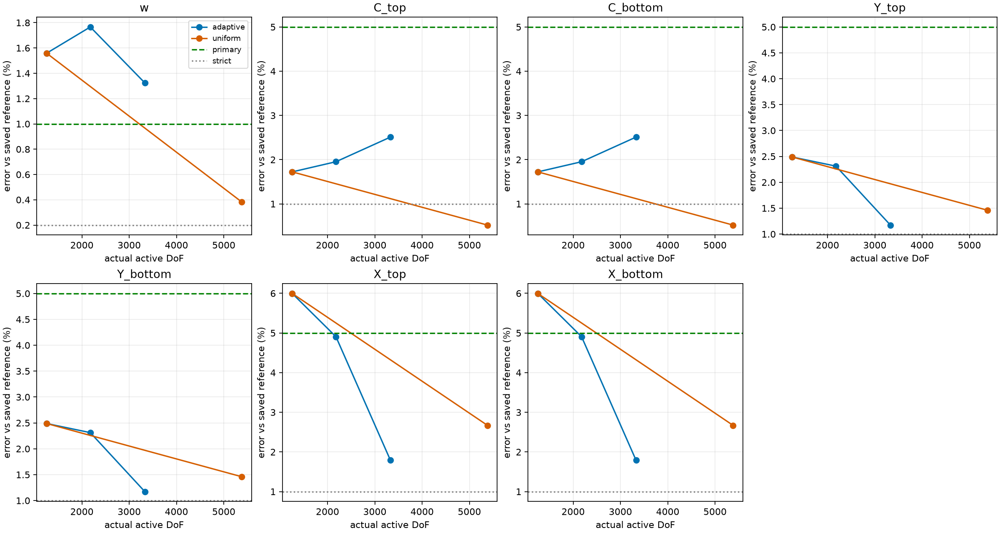
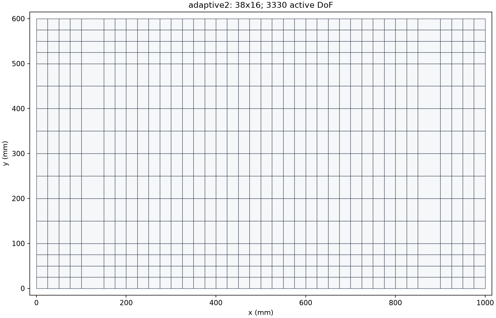

# Выполненное сравнение полосовой адаптации и uniform P1

Ветка `windows/ansys-bootstrap`, исходный HEAD
`4582fefd4e66804e866d7ae9432472588d344f6e`. Дата: 17.11.2026 (Москва).

**Цикл реализован и выполнен.** Реально завершены четыре новых solve:
общий старт, два адаптивных шага, отдельный uniform h=25 mm.
Третий адаптивный шаг отклонён **до solve** по бюджету. Uniform достиг
основной цели; адаптация — нет из-за прогиба. Строгая цель не достигнута
ни одним методом. Преимущество адаптации по совокупной цели не получено.

Код: [strip_adaptivity](../experiments/ansys_panel/strip_adaptivity/README.md).
Данные: [20261117_strip01](../experiments/ansys_panel/strip_adaptivity/runs/20261117_strip01/),
[CSV всех семи ошибок и времени](../experiments/ansys_panel/strip_adaptivity/runs/20261117_strip01/comparison.csv),
[аудит и итоговые затраты с отказом](../experiments/ansys_panel/strip_adaptivity/audits/20261117_review01/).

## Постановка, правило сгущения и выполненные solve

Неизменная P1 linear: 1000×600×8 mm, E=210000 MPa, ν=0.3, заделка
всех шести DOF на четырёх кромках, давление 0.005 N/mm² по +Z, +3000 N.
SHELL181 KEYOPT(1)=0/(3)=2/(8)=2, ETCONTROL,OFF, MID, NIP=5,
NLGEOM,OFF, sparse, nproc=2/-smp. Нет пластичности, веса или температуры.

[Протокол](ANSYS_PANEL_STRIP_PROTOCOL_20261117.md) и JSON сохранены до
первого запуска новой серии; SHA-256
`6a39259b18d9c97023f41fa4ff77792d7fd8c7b3def05f9a668462759f732870`.
Дёрфлер θ=0.5, минимальный префикс по убыванию η², точные равенства по ID.
Отмеченная ячейка делит более длинный интервал; равенство выбирает X.
Все линии проходят через панель. Это **полосовое сгущение**, не произвольная
локальная h-сетка. Reference не входит в selector, recovery или наблюдение.

| Стадия | Интервалы X×Y | Элементы | Прогноз DoF | Native Number of equations | Статус |
|---|---:|---:|---:|---:|---|
| Общий старт | 20×12 | 240 | 1254 | 1254 | Solve завершён один раз для обоих методов |
| Adaptive 1 | 34×12 | 408 | 2178 | 2178 | Solve завершён |
| Adaptive 2 | 38×16 | 608 | 3330 | 3330 | Solve завершён |
| Предложение Adaptive 3 | 49×24 | 1176 | 6624 | — | Отклонено до solve: cap=5382 |
| Uniform h=25 | 40×24 | 960 | 5382 | 5382 | Новый solve завершён |

На первом/втором/третьем предложениях отмечено 54/88/146 элементов,
добавилось бы 14/8/19 глобальных линий. Дополнительных closure-линий
не понадобилось (0/0/0); код учитывает их и тестирует отдельно.
θ, интервалы, маркировка и cap не менялись после получения ошибок.
Сопоставление выполнено **под общим cap**, фактические DoF различаются.
3330 DoF — 61.87% верхнего бюджета, но свободное место не заполнялось
изменением θ или удалением части отметок.

## Точность относительно сохранённого компаратора

Reference — только сохранённый P1 linear h=3.125 mm, w=0.15551121657326225 mm.
Он принят по прежнему аудиту для этих метрик, но не является точным решением;
неуспешная дополнительная проверка legacy RST-reader остаётся ограничением.
Ошибки ниже имеют знаменатель |reference| и не являются соседними
изменениями при стабилизации reference.

| Сетка | w, mm | e_w, % | e_C TOP, % | e_C BOTTOM, % | e_Y TOP, % | e_Y BOTTOM, % | e_X TOP, % | e_X BOTTOM, % |
|---|---:|---:|---:|---:|---:|---:|---:|---:|
| Старт | 0.153087293 | 1.5587 | 1.7237 | 1.7237 | 2.4883 | 2.4883 | 5.9964 | 5.9964 |
| Adaptive 1 | 0.152764842 | 1.7660 | 1.9529 | 1.9529 | 2.3120 | 2.3120 | 4.9067 | 4.9067 |
| Adaptive 2 | 0.153451652 | 1.3244 | 2.5100 | 2.5100 | 1.1734 | 1.1734 | 1.7908 | 1.7908 |
| Uniform 25 | 0.154916843 | 0.3822 | 0.5207 | 0.5207 | 1.4600 | 1.4600 | 2.6702 | 2.6702 |

| Метод / стадия | Прогиб≤1% | Все шесть VM≤5% | Основная цель целиком | Строгая: прогиб≤0.2% и все VM≤1% |
|---|---|---|---|---|
| Старт | Нет | Нет | Нет | Нет |
| Adaptive 1 | Нет | Да | Нет | Нет |
| Adaptive 2 | Нет | Да | Нет | Нет |
| Uniform 25 | Да | Да | **Да** | Нет |

Первое полосовое сгущение ухудшило прогиб, несмотря на уменьшение η².
Это сохранённый результат, а не причина менять правило. На втором шаге
адаптация дала меньшие ошибки Y/X и меньший худший площадочный VM, чем
uniform25, при меньшем DoF; однако центральный прогиб и круг C хуже.
Нельзя объявить выигрыш по совокупной цели или одинаковой точности.
Геометрическое правило longest-interval не является goal-oriented методом.
Энергетический индикатор не гарантирует монотонного уменьшения семи ошибок.

Интерполяция учитывает реальные неравномерные X/Y. Центральный прогиб
берётся в физической точке (500,300), включая случай отсутствия узла.
Для кругов R=8 mm используются те же C/Y/X, глобальный тензор интерполируется
билинейно, затем вычисляется VM и средний интеграл. TOP/BOTTOM экспортируются
раздельно через native FULL/RSYS0/LAYER1/AVPRIN0/NODE S ESOL.
Их совпадение в этой линейной задаче не объединяет шесть проверок.
Все квадратуры прошли два последовательных перехода с прежним допуском
0.05%. Ограничения сглаженного восстановленного узлового поля сохраняются;
это не новая оценка несглаженных точек интегрирования напряжений.

## N/M/Q-индикатор и исправление native секционного чтения

Несглаженные центроидные SMISC 1–8 экспортированы непосредственно из MAPDL:
N11,N22,N12,M11,M22,M12,Q13,Q23. Нет подмены узловыми напряжениями.
Фактические ESYS=0, KEYOPT(11)=0, связность и координаты проверены.
Из native геометрии вычислен базис S1/S2/+Z; на этих прямоугольниках он
совпадает с XY. Код всё равно выполняет тензорное преобразование N/M и Q;
его инвариантность проверяется синтетическими тестами поворота.

В каждом узле — площадной взвешенный МНК линейного полинома на центрах
соседних элементов. Патч расширялся по общим вершинам; максимальное
расширение 1 кольцо, максимальный condition≈8.533 против лимита 1e8,
ранг везде 3. Константного fallback нет. Восстановление Q4 и η_K²
интегрируются по площади; 2×2 и 3×3 согласовались, выбран 3×3.
Мембранная/изгибная/сдвиговая части имеют единицы N·mm и не содержат
подобранных весов или reference-ошибок.

| Сетка | Ση_N², N·mm | Ση_M², N·mm | Ση_Q², N·mm | Ση², N·mm |
|---|---:|---:|---:|---:|
| Старт | ≈1.3e−32 | 6.187563 | 0.009016 | 6.196579 |
| Adaptive 1 | ≈1.5e−32 | 5.710992 | 0.008367 | 5.719359 |
| Adaptive 2 | ≈1.4e−32 | 2.802632 | 0.005367 | 2.807999 |
| Uniform 25 | ≈1.3e−32 | 1.631466 | 0.002727 | 1.634192 |

Перед запуском адаптации обнаружена ошибка дополнительного условия нового
экспортёра: GET секции E возвращал Gt=646153.846 N/mm, а нужная коррекция
содержалась в TS11/TS22≈0.833333326667, TS12=0. Правильное секционное
S=TS·E=538461.534154 I N/mm непосредственно подтверждено native GET.
Материал, секция и модель **не изменялись**.

Независимо экспортированные центроидные Q и γ не обязаны образовывать
точное равенство Q=Sγ. Их остаток около 0.0244% на h50 и его изменение
с геометрией сохранены диагностически; конкретная причина не установлена.
Влияние assumed-shear/несовместимых мод — гипотеза, не доказанный диагноз.
Дополнительная попытка определить постоянную матрицу по Q/γ не прошла
неравномерную сетку при исходном допуске 1e−6 и **отклонена**, допуск не повышался.
В валидном цикле применяется секционная S из E/TS, как требует A/D/S-метрика.
Это по-прежнему не точная дискретная норма SHELL181 и не гарантированная
верхняя граница FE-ошибки.

Прежние результаты попытки сохранены в `diagnostics/` и приватно.
Повторная обработка стартового RST дала **те же 54 отмеченных ID и все
координатные линии**, что подтверждено `section_reprocessing_proof.json`.
Поэтому уже решённый adaptive1 относится к исправленной траектории;
ни он, ни стартовый solve не повторялись. Исправление имени RST после
/CLEAR, путей импорта publisher и regex аудитора также потребовало только
чтения/обработки сохранённых результатов. В native APDL наблюдаются ровно
четыре команды SOLVE.

## Качество, физические проверки и время

Во всех четырёх моделях прошёл прежний полный геометрический валидатор:
Q4, совпадающие рёбра, отсутствие висячих/дублированных узлов, пересечений,
наложений, положительные Jacobian/+Z, площадь 600000 mm², сохранённые
TYPE/MAT/SECNUM/t и фактические ETLIST/SLIST. Native shape tests включены,
на всех элементах ноль warnings/errors. Предупреждений решателя нет;
обычные NOTE сохраняются. Raw SOLU CNVG=0 линейного solver не выдаётся
за отказ: подтверждены завершённый подшаг TIME=1 и sparse equations.

Сила/момент реакции согласованы с +3000 N и (900000,−1500000,0) N·mm;
наибольшая относительная невязка силы≈1.20e−12, момента≈1.30e−12.
SENE и половина внешней работы имеют единицы N·mm, их максимальная
разность≈4.67e−9 относительно SENE. Площадь, P1 и давление независимо
проверены по native DBLOCK/SFEBLOCK до каждого solve.

| Метод/состояние | Накопленные измеренные стадии, s | С общей эксплуатационной частью, s |
|---|---:|---:|
| Общий старт (отнесён к обоим) | 2.9833 | 284.8109 |
| Adaptive 1 | 7.8775 | 289.7051 |
| Adaptive 2, сразу после solve/экспорта | 14.8687 | 296.6962 |
| Adaptive, терминально с отказом шага 3 | **15.0058** | **296.8334** |
| Uniform 25, включая общий старт | **12.9265** | **294.7540** |

Таблица основного comparison.csv содержит состояния после завершённых
solve. Дополнительные 0.137122 s маркировки/построения отвергнутого шага 3
учтены в терминальной [таблице аудита](../experiments/ansys_panel/strip_adaptivity/audits/20261117_review01/terminal_costs.csv).
Сохранены отдельные времена build/solve/export/native checks/indicator/
graph/mark/remesh и прочих промежутков. Это новые измерения, не исторические
времена uniform solve. Одинаковая recovery/graph диагностика выполнялась и
для uniform; её стоимость не скрыта.

Общий старт фактически один. При сравнении самостоятельных методов его
стоимость относится к обоим полностью; физическое выполнение не суммирует
его дважды. Общая эксплуатационная часть 281.8276 s включает все измеренные
запуски/закрытия, технические отказы и повторную обработку. В начале vendor
лицензирования был недоступен (FlexNet −97,121); пользователь восстановил
лицензию. Ожидание пользователя и редактирование кода не включены в таймеры.
Этот общий штраф также целиком относится к обоим методам.

После ImportError publisher длительность одной завершённой попытки
восстановлена по интервалу runtime launch-input → post-exit checkpoint:
50.1102 s, с native elapsed=49.209 s как независимой проверкой масштаба.
Это wall-clock envelope, **не первоначальный монотонный таймер**; его
ограничение явно записано. Финальная публикация выполнялась без MAPDL,
отдельно измерена: 1.2695 s. Сумма фактических попыток с публикацией≈308.0460 s,
за исключением финальных небольших stamp/hash writes. Полные кривые времени
не являются статистическим benchmark: один пилот, эксплуатационные отказы,
повторная обработка и восстановленный интервал. По измеренным стадиям
адаптация тоже медленнее (15.0058 против 12.9265 s), выигрыша не заявляется.
Общий terminal overhead на графиках не называется фактическим временем
промежуточного достижения цели: будущий close не приписывается событию.

Исходная сетка и uniform также сохранены в shared0/mesh.png и uniform25/mesh.png;
ошибки по времени — errors_vs_time.png. Runtime DB/RST/FULL и полные
native логи остаются приватно, исторические серии не изменены.

## Проверки и дальнейшее подключение ASMR++

Пройдены 30 новых тестов сетки/recovery/контрактов runner и 10 прежних
тестов интерполяции. Офлайн-аудит повторил геометрию, native load evidence,
семь метрик, N/M/Q-поворот, индикаторы и все предложения маркировки/сетки.
Он не выполнил solve. Producer manifest сохранён, исправленный аудитор
имеет отдельный source hash: старые хеши не переписываются ради исправления.

Подготовлен `selector(observation) → scores_per_element`, классический
selector возвращает η². Экспортирован граф элементов: центры/размеры/площади,
соседство по целым рёбрам, глобальные N/M/Q, три вклада индикатора и сумма.
18 признаков имеют физические нормировщики a,b,ab, |p|b, |p|b²,
p²b⁶/D11. Нормирование не использует reference и обученную статистику.

Для ASMR++ остаются совместимый механический observation adapter, бюджетное
действие над интервалами, reward по семи величинам/времени, новые механические
train/test задачи и независимая проверка политики. Это подготовленный интерфейс,
**не нейросетевой эксперимент**. Старый Poisson checkpoint не загружался;
обучение/inference не выполнялись. Работающий классический цикл сохранён,
хотя в этом cap основную цель достиг только uniform25.

Источники API: [SHELL181 v261](https://ansyshelp.ansys.com/public/Views/Secured/corp/v261/en/ans_elem/Hlp_E_SHELL181.html),
[GET секционных E/TS](https://ansyshelp.ansys.com/public/Views/Secured/corp/v261/en/ans_cmd/Hlp_C_GET.html),
[теория assumed shear](https://ansyshelp.ansys.com/public/Views/Secured/corp/v261/en/ans_thry/thy_el181.html).
