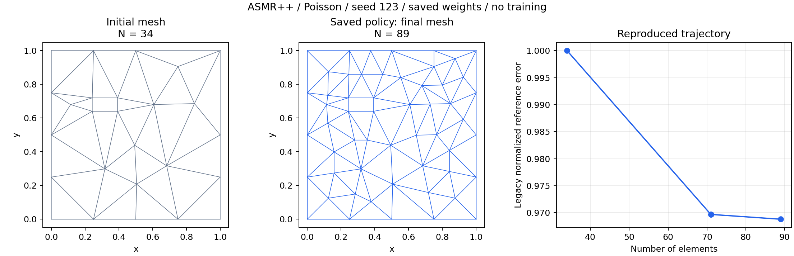

# ASMR++: восстановление сохранённой модели

Дата: 2026-11-15. Продолжение [научного журнала](ASMR_RESEARCH_LOG.md).

## Результат

Найдены и сохранены исходники ASMR++, разрешённая конфигурация запуска
`poisson_asmr_train10`, checkpoints, нормализаторы и описание архитектуры.
На существующем Ubuntu-окружении восстановлен inference финальной PPO-политики.
Обучение не выполнялось. Исторические CSV, скрипты и графики сохранены.

Базовый upstream commit — `228bb6389cc8c0af9be8c94df7569fd6013a4e89`
репозитория https://github.com/NiklasFreymuth/ASMRplusplus (MIT).
Единственное локальное изменение отслеживаемого кода — замена обращений
`collections.MutableMapping/MutableSequence` на `collections.abc`.
Полный снимок 209 отслеживаемых файлов и соответствующий patch включены
в [комплект](../experiments/asmrpp/reproduce/README.md).

## Контрольные суммы ключевых входов

| Артефакт | SHA-256 |
| --- | --- |
| `config.yaml` | `dee0f4d25219bfcc7fb7957fde1cb04bb0e3ce1f25a45af9c09686d5f0cb7212` |
| `ckpt_final.pt` | `132cb2432f162c0b1513910ecd5f5837456dc9ab4d455c088e83018ab54b1144` |
| `ckpt0000.pt` | `5e19eace122620560a71fe76e04a92f1667c01661fe63c6536685a505c6daf0c` |

Хеши нормализаторов, архитектуры, исходников и прочих входов указаны в
`experiments/asmrpp/reproduce/manifest.json`. Снимок исключает произвольные
неотслеживаемые файлы исходного рабочего каталога.

## Проверка одной исторической задачи

Использованы evaluation environment 1, seed 123, λ = 0.001274, CPU, один поток.
Сеть загружалась из `ckpt_final.pt` вместе с `ckpt_final_norm_params.pkl` и
`network_kwargs.npz`. Выбрана первая задача прежнего сравнения, case 0.
Конфигурация указывает NumPy/PyTorch training seeds 0 и 10 итераций обучения;
исходная командная строка обучающего запуска по-прежнему не установлена.

| Шаг | Элементы | Нормированная reference-метрика |
| --- | ---: | ---: |
| 0 | 34 | 0.999999999994 |
| 1 | 71 | 0.969678475774 |
| 2 | 71 | 0.969678475774 |
| 3 | 71 | 0.969678475774 |
| 4 | 89 | 0.968785378584 |

Число элементов и вершин, а также ошибки на всех пяти состояниях совпали
с case 0 метода `ASMR++ PPO` в `results/cases.csv` (rtol 1e−9, atol 1e−10).
Два запуска в независимых процессах дали идентичные хеши сеток и нулевую
разность ошибок. Параметры и буферы state_dict сети не изменились.

Проверены защитные условия: изменённый вход отвергается по SHA-256;
существующий output-каталог не перезаписывается. Целостность исходного
локального кода, checkpoint-файлов, конфигурации и исторического архива
проверена отдельно после запуска.



Все измерения и подтверждения:

- [Траектория CSV](../experiments/asmrpp/runs/recovered_20261115_seed123/trace.csv).
- [Результат JSON](../experiments/asmrpp/runs/recovered_20261115_seed123/result.json).
- [Повтор в независимом процессе](../experiments/asmrpp/runs/recovered_20261115_seed123/repeat_verification.json).
- [Проверки целостности и запрета перезаписи](../experiments/asmrpp/runs/recovered_20261115_seed123/integrity_checks.json).

## Окружение и границы подтверждения

По `result.json` и `environment/installed_packages.json` фактически использованы
Python 3.10.22, PyTorch 2.1.2, NumPy 1.23.5,
SciPy 1.10.1, scikit-fem 9.0.0 и сохранённое окружение `ASMRpp_cpu`.
Полный список версий и исходные локальные файлы окружения включены в комплект.
При этом исходный YAML и `conda_packages.json` указывают NumPy 1.22.3:
метаданные conda и фактическая версия Python-пакета расходятся. Для последующего
воссоздания окружения это расхождение необходимо разрешить, ориентируясь на
фактически исполненный runtime; исходные файлы окружения оставлены без изменений.
Проверка на заново созданном окружении или другой машине ещё не выполнялась.

Это подтверждает загрузку конкретного checkpoint и воспроизведение одной
ранее записанной траектории. Оно не подтверждает точность reference, независимость
test от train, результаты остальных девяти задач, преимущество при равных DoF,
ускорение или перенос политики на упругость и ANSYS. Восстановленные raw-файлы
позволяют исследовать эти вопросы на следующих этапах.

## Проверка сохранённого комплекта перед передачей на Windows

После получения ветки `repro/recover-asmr-runtime` из GitHub выполнено:

```bash
python3 -B experiments/asmrpp/reproduce/reproduce.py --verify-only
```

Результат: `Verified 17 artifacts; upstream 228bb6389cc8c0af9be8c94df7569fd6013a4e89`,
код возврата 0. Отдельно проверены SHA-256 всех 209 файлов внутри tar.gz,
обратная применимость patch и соответствие сохранённых trace/result историческому
case 0. Все 44 файла `experiments/asmrpp/` совпали с коммитом `c9aa797`,
а 12 исторических файлов — с импортом `8878794`.

Это новая проверка целостности и согласованности уже сохранённых результатов,
а не новый inference. В текущей облачной среде модель повторно не запускалась,
зависимости не устанавливались. Передача и ограничения описаны в
[WINDOWS_HANDOFF.md](WINDOWS_HANDOFF.md).
